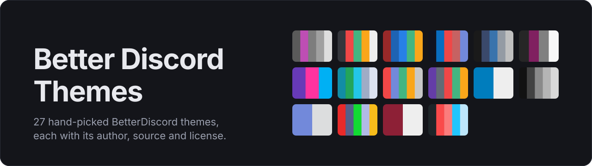
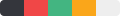
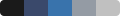
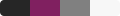
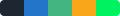
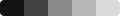
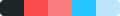

  

  A collection of BetterDiscord themes with the author, source and license of every one. 
  Thirty are hand-picked and previewed below. More than eight hundred open-source themes sit in the catalog beside them.

  <a href="https://vaporjawn.dev/better-discord-themes/"><b>Browse the site</b></a> &nbsp;|&nbsp;
  <a href="#install">Install</a> &nbsp;|&nbsp;
  <a href="#hand-picked-themes">Hand-picked themes</a> &nbsp;|&nbsp;
  <a href="THEMES.md">Full catalog</a> &nbsp;|&nbsp;
  <a href="CONTRIBUTING.md">Contribute</a>

  
  
  
  

## Install

1. In Discord with [BetterDiscord](https://betterdiscord.app) installed, open **Settings > Themes > Open Themes Folder**.
2. Save the `.theme.css` file you want into that folder. Every theme below has a **Raw** link: open it, then save the page.
3. Switch the theme on in **Settings > Themes**.

Most themes pull the rest of their styles from the author's own host, so they need an internet connection. Options such as colors and background images are listed at the top of each file.

## Hand-picked themes

The color strips are the colors each theme uses most, read from its own stylesheet. Themes that load all of their styles from a remote file have no strip.

<!-- BEGIN THEMES -->
| Colors | Theme | About | Links |
| --- | --- | --- | --- |
|  | **BasicBackground Personal** 1.0.0 by Vaporjawn | Allows you to use a background image in Discord without greatly altering the basic look of Discord. | [Raw](https://raw.githubusercontent.com/Vaporjawn/better-discord-themes/main/curated/basic.theme.css) · [Source](https://github.com/Vaporjawn/better-discord-themes) |
|  | **BasicBackground** 1.0.5 by DevilBro | Allows you to use a Background Image without greatly altering the basic Layout of Discord | [Raw](https://raw.githubusercontent.com/Vaporjawn/better-discord-themes/main/curated/BasicBackground.theme.css) · [Source](https://github.com/mwittrien/BetterDiscordAddons/tree/master/Themes/BasicBackground/) |
|  | **BetterDocsBlock** 1.0.0 by Unknown (collected by Vaporjawn) | Styles the warning embed and link logos used to flag blocked BetterDocs links. | [Raw](https://raw.githubusercontent.com/Vaporjawn/better-discord-themes/main/curated/BetterDocsBlock.theme.css) · [Source](https://github.com/Vaporjawn/better-discord-themes) |
|  | **Black Hole** 1.0 by MonsterDev | Jump into space with this theme. It's just a bedazzled base Discord theme | [Raw](https://raw.githubusercontent.com/Vaporjawn/better-discord-themes/main/curated/Black-Hole.theme.css) · [Source](https://github.com/monstrousdev/themes/theme-files/Black-Hole.theme.css) |
|  | **BlurpleRecolor** 1.0.0 by DevilBro | Replaces Discord's native blurple with your own color. Change the color in the theme file. | [Raw](https://raw.githubusercontent.com/Vaporjawn/better-discord-themes/main/curated/BlurpleRecolor.theme.css) · [Source](https://github.com/mwittrien/BetterDiscordAddons/tree/master/Themes/BlurpleRecolor) |
|  | **ClearVision** 6.3.0 by ClearVision Team | Highly customizable theme for BetterDiscord. | [Raw](https://raw.githubusercontent.com/Vaporjawn/better-discord-themes/main/curated/ClearVision_v6.theme.css) · [Source](https://github.com/ClearVision/ClearVision-v6) |
|  | **Comfy** 2.4 by Nyria#3863 | Stay comfy while talking to your friends | [Raw](https://raw.githubusercontent.com/Vaporjawn/better-discord-themes/main/curated/comfy.theme.css) · [Source](https://github.com/Comfy-Themes/Discord) |
|  | **Discord Dark** 1.39 by SyndiShanX | A Github Dark Theme for Discord, meant to be used with Discord Dark Mode | [Raw](https://raw.githubusercontent.com/Vaporjawn/better-discord-themes/main/curated/discorddark.theme.css) · [Source](https://github.com/SyndiShanX/Discord-Dark) |
|  | **Discord+** 3.1.1 by PlusInsta | A sleek, customizable Discord theme. | [Raw](https://raw.githubusercontent.com/Vaporjawn/better-discord-themes/main/curated/DiscordPlus.theme.css) · [Source](https://github.com/PlusInsta/discord-plus/blob/master/DiscordPlus-source.theme.css) |
|  | **dracula** 1.3.1 by slowstab | a dark mode discord theme based on the dracula color palette. | [Raw](https://raw.githubusercontent.com/Vaporjawn/better-discord-themes/main/curated/dracula.theme.css) · [Source](https://github.com/slowstab/dracula/blob/main/dracula.scss) |
|  | **Frosted Glass** 2.0.0 by Gibbu#1211 | Display your picture of choice with adjustable blur and brightness. Dark theme is required. | [Raw](https://raw.githubusercontent.com/Vaporjawn/better-discord-themes/main/curated/FrostedGlass.theme.css) · [Source](https://github.com/DiscordStyles/FrostedGlass) |
|  | **Vibrant Glass** 1.0 by Kaynooo#8080 | Simple customizable glass theme. | [Raw](https://raw.githubusercontent.com/Vaporjawn/better-discord-themes/main/curated/glass_local.theme.css) · [Source](https://github.com/Kayno0o/vibrant-glass-theme) |
|  | **Horizontal Server List** 2.1.0 by Gibbu#1211 | Moves the server list from the left to the top of Discord. Compatible with Server Folders and most basic transparent themes | [Raw](https://raw.githubusercontent.com/Vaporjawn/better-discord-themes/main/curated/HorizontalServerList.theme.css) · [Source](https://github.com/DiscordStyles/HorizontalServerList) |
|  | **kaleidoscope** 2.4.2 by mackenzie#0173 | A vibrant, colourful dark theme inspired by the 2077 theme for VSCode. | [Raw](https://raw.githubusercontent.com/Vaporjawn/better-discord-themes/main/curated/kaleidoscope.theme.css) · [Source](https://github.com/spinfish/kaleidoscope) |
|  | **Material Discord** 3.0.4 by CapnKitten | A theme based on Google's Material Design | [Raw](https://raw.githubusercontent.com/Vaporjawn/better-discord-themes/main/curated/Material-Discord.theme.css) · [Source](https://github.com/CapnKitten/BetterDiscord/blob/master/Themes/Material-Discord/css/source.css) |
|  | **midnight** 1.6.1 by refact0r | A darkened discord theme. | [Raw](https://raw.githubusercontent.com/Vaporjawn/better-discord-themes/main/curated/Midnight.theme.css) · [Source](https://github.com/refact0r/midnight-discord) |
|  | **MinimalCord** 2.0.0 by Gibbu#1211 | Changes Discord enough to give it a fresh feel while also making it darker. Supports both Light and Dark themes. | [Raw](https://raw.githubusercontent.com/Vaporjawn/better-discord-themes/main/curated/MinimalCord.theme.css) · [Source](https://github.com/DiscordStyles/MinimalCord) |
|  | **Newcord** 1.0.1 by ₊˚ʚ 𝑘𝑎𝑖𝑑𝑜ˊ˗ | A colorful theme inspired by the first page of Discord's website. | [Raw](https://raw.githubusercontent.com/Vaporjawn/better-discord-themes/main/curated/newcord.theme.css) · [Source](https://github.com/kaiidoo/Newcord) |
|  | **Nocturnal** 3.0.1 by Spectra | For when default discord just isn't dark enough, a theme for those who live a night | [Raw](https://raw.githubusercontent.com/Vaporjawn/better-discord-themes/main/curated/nocturnal.theme.css) · [Source](https://github.com/xcruxiex/themes) |
|  | **NotAnotherAnimeTheme** 3.2 by puckzxz#2080 | An easily customizable and automatically updating theme | [Raw](https://raw.githubusercontent.com/Vaporjawn/better-discord-themes/main/curated/NotAnotherAnimeTheme.theme.css) · [Source](https://github.com/puckzxz/NotAnotherAnimeTheme) |
|  | **OperaGxGamingTheme** 0.0.9 by TomRdh | Opera GX Gaming Theme! A (transparent) gaming theme inspired by Opera GX. Very customizable in the theme file. | [Raw](https://raw.githubusercontent.com/Vaporjawn/better-discord-themes/main/curated/OperaGxGamingTheme.theme.css) · [Source](https://github.com/Tomrdh/discord-addons/blob/master/download-themes-here/OperaGxGamingTheme) |
|  | **RadialStatus** 2.0.0 by Gibbu#1211 | Changes the status icons to wrap around the avatar. Shape can be changed inside the theme file. | [Raw](https://raw.githubusercontent.com/Vaporjawn/better-discord-themes/main/curated/RadialStatus.theme.css) · [Source](https://github.com/DiscordStyles/RadialStatus) |
|  | **Reborn** 1.5 by MonsterDev | Phoenix Theme Bundle: Transparent, fully customizable theme with multiple addons | [Raw](https://raw.githubusercontent.com/Vaporjawn/better-discord-themes/main/curated/Reborn.theme.css) · [Source](https://github.com/monstrousdev/themes/theme-files/Reborn.theme.css) |
|  | **ServerColumns** 1.0.6 by DevilBro | Changes the Server List to a grid-like Structure which allows any Amount of Columns | [Raw](https://raw.githubusercontent.com/Vaporjawn/better-discord-themes/main/curated/ServerColumns.theme.css) · [Source](https://github.com/mwittrien/BetterDiscordAddons/tree/master/Themes/ServerColumns/) |
|  | **Spotify Discord** 2.0.0 by CapnKitten | Combine Discord and Spotify into one | [Raw](https://raw.githubusercontent.com/Vaporjawn/better-discord-themes/main/curated/Spotify-Discord.theme.css) · [Source](https://github.com/CapnKitten/BetterDiscord/blob/master/Themes/Spotify-Discord/css/source.css) |
|  | **ThemeDevBadge** 1.0.0 by Unknown (collected by Vaporjawn) | Adds a theme developer badge image through a CSS variable. | [Raw](https://raw.githubusercontent.com/Vaporjawn/better-discord-themes/main/curated/ThemeDevBadge.theme.css) · [Source](https://github.com/Vaporjawn/better-discord-themes) |
|  | **Tokyo Night** 2.0.2 by Ashtrath | Discord Port of Visual Studio Code Theme | [Raw](https://raw.githubusercontent.com/Vaporjawn/better-discord-themes/main/curated/tokyo-night.theme.css) · [Source](https://github.com/ashtrath/Tokyo-Night) |
|  | **Tranquil** 1.5 by MonsterDev | Phoenix Theme Bundle: Primarily dark theme that's easy on the eyes [Also supports light theme which is less easy on the eyes] | [Raw](https://raw.githubusercontent.com/Vaporjawn/better-discord-themes/main/curated/Tranquil.theme.css) · [Source](https://github.com/monstrousdev/themes/theme-files/Tranquil.theme.css) |
|  | **Weed** 1 by Trator de Jacare#3219 | Don't worry about a thing, every little thing is gonna be alright. | [Raw](https://raw.githubusercontent.com/Vaporjawn/better-discord-themes/main/curated/Weed-Leaf.theme.css) · [Source](https://github.com/jpmn333/Weed-Leaf) |
|  | **Zelk** 1.2.2 by schnensch | a smooth theme inspired by zorin | [Raw](https://raw.githubusercontent.com/Vaporjawn/better-discord-themes/main/curated/zelkBD.theme.css) · [Source](https://github.com/schnensch0/zelk) |
<!-- END THEMES -->

## What is where

| Folder | Contents |
| --- | --- |
| [`curated/`](curated/) | The hand-picked themes in the table above |
| [`themes/`](themes/) | The catalog: open-source themes copied from their repositories as `owner/repo`, each with its upstream license. See [THEMES.md](THEMES.md) |
| [`archive/`](archive/) | Themes written for Discord's 2018 class names that no longer match |
| [`vendor/`](vendor/) | An unmodified copy of an older theme collection, kept for its SCSS sources |
| [`docs/`](docs/) | The GitHub Pages site and its `themes.json` |
| [`assets/`](assets/) | Banner, color strips and images |
| [`scripts/`](scripts/), [`test/`](test/) | Theme validators and the index builder, with tests |
| [`.github/`](.github/) | Workflows, issue templates, code of conduct, security policy |

Run `npm run build:index` after adding or renaming a theme in `curated/`. It rewrites the table above, the color strips, the banner and `docs/themes.json`.

## Contribute in three ways

| I want to... | Do this |
| --- | --- |
| **Suggest a theme** (no coding) | [Open the theme form](https://github.com/Vaporjawn/better-discord-themes/issues/new?template=theme_request.yml) |
| **Report a broken theme** | [Open the bug form](https://github.com/Vaporjawn/better-discord-themes/issues/new?template=bug_report.yml) |
| **Add or fix a theme myself** | Fork the repo, or [add a file in your browser](https://github.com/Vaporjawn/better-discord-themes/new/main) (GitHub offers to fork for you), then open a pull request |

What happens next:

1. You open an issue or pull request. First-time contributors get a welcome message.
2. The **Validate themes** check runs on every pull request and says which theme is missing which meta field.
3. A maintainer reviews the license and the result, and merges or replies.
4. Your name appears in the Contributors list below once your pull request is merged.

Looking for a first task? See the [good first issues](https://github.com/Vaporjawn/better-discord-themes/issues?q=is%3Aopen+label%3A%22good+first+issue%22) and [help wanted](https://github.com/Vaporjawn/better-discord-themes/issues?q=is%3Aopen+label%3A%22help+wanted%22). Full rules are in [CONTRIBUTING.md](CONTRIBUTING.md), the [code of conduct](.github/CODE_OF_CONDUCT.md) and the [security policy](.github/SECURITY.md).

## Contributors

Everyone who has contributed code, fixes or themes:

Theme authors are credited in [THIRD_PARTY_NOTICES.md](THIRD_PARTY_NOTICES.md).

## License

The repository's own files (README, site, scripts, workflows) are MIT licensed: see [LICENSE](LICENSE). Every theme keeps its author's license: see [THIRD_PARTY_NOTICES.md](THIRD_PARTY_NOTICES.md). Themes marked "Unknown (collected by Vaporjawn)" have no identified author and are listed so their origin can be corrected.
