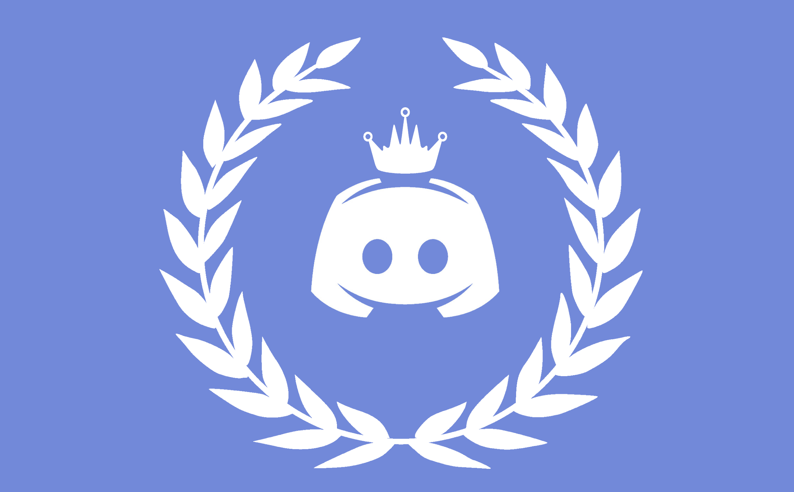

<h1 align="center">
Better Discord Themes

</h1>

<h2 align="center">A compilation of better discord themes</h2>

&#160;&#160;&#160;&#160;

A collection of BetterDiscord themes, most of them gathered from their original authors, plus a few of my own. Each theme keeps its original author, version and source in its header.

## Install

1. Open Discord with BetterDiscord installed, then go to **Settings > Themes > Open Themes Folder**.
2. Download the `.theme.css` file you want from the table below (use the raw link, then save the file) and drop it into that folder.
3. Enable it in **Settings > Themes**.

Most themes load the rest of their styles from their authors' hosts through `@import`, so they need an internet connection. Themes with options (colors, background images) list them near the top of the file.

## Themes

<!-- BEGIN THEMES -->
| Name | Author | Version | Description | Raw link | Original source |
| --- | --- | --- | --- | --- | --- |
| BasicBackground Personal | Vaporjawn | 1.0.0 | Allows you to use a background image in Discord without greatly altering the basic look of Discord. | [raw](https://raw.githubusercontent.com/Vaporjawn/better-discord-themes/main/basic.theme.css) | [source](https://github.com/Vaporjawn/better-discord-themes) |
| BasicBackground | DevilBro | 1.0.5 | Allows you to use a Background Image without greatly altering the basic Layout of Discord | [raw](https://raw.githubusercontent.com/Vaporjawn/better-discord-themes/main/BasicBackground.theme.css) | [source](https://github.com/mwittrien/BetterDiscordAddons/tree/master/Themes/BasicBackground/) |
| BetterDocsBlock | Unknown (collected by Vaporjawn) | 1.0.0 | Styles the warning embed and link logos used to flag blocked BetterDocs links. | [raw](https://raw.githubusercontent.com/Vaporjawn/better-discord-themes/main/BetterDocsBlock.theme.css) | [source](https://github.com/Vaporjawn/better-discord-themes) |
| Black Hole | MonsterDev | 1.0 | Jump into space with this theme. It's just a bedazzled base Discord theme | [raw](https://raw.githubusercontent.com/Vaporjawn/better-discord-themes/main/Black-Hole.theme.css) | [source](https://github.com/monstrousdev/themes/theme-files/Black-Hole.theme.css) |
| BlurpleRecolor | DevilBro | 1.0.0 | Replaces Discord's native blurple with your own color. Change the color in the theme file. | [raw](https://raw.githubusercontent.com/Vaporjawn/better-discord-themes/main/BlurpleRecolor.theme.css) | [source](https://github.com/mwittrien/BetterDiscordAddons/tree/master/Themes/BlurpleRecolor) |
| ClearVision | ClearVision Team | 6.3.0 | Highly customizable theme for BetterDiscord. | [raw](https://raw.githubusercontent.com/Vaporjawn/better-discord-themes/main/ClearVision_v6.theme.css) | [source](https://github.com/ClearVision/ClearVision-v6) |
| Comfy | Nyria#3863 | 2.4 | Stay comfy while talking to your friends | [raw](https://raw.githubusercontent.com/Vaporjawn/better-discord-themes/main/comfy.theme.css) | [source](https://github.com/Comfy-Themes/Discord) |
| Discord Dark | SyndiShanX | 1.39 | A Github Dark Theme for Discord, meant to be used with Discord Dark Mode | [raw](https://raw.githubusercontent.com/Vaporjawn/better-discord-themes/main/discorddark.theme.css) | [source](https://github.com/SyndiShanX/Discord-Dark) |
| dracula | slowstab | 1.3.1 | a dark mode discord theme based on the dracula color palette. | [raw](https://raw.githubusercontent.com/Vaporjawn/better-discord-themes/main/dracula.theme.css) | [source](https://github.com/slowstab/dracula/blob/main/dracula.scss) |
| Frosted Glass | Gibbu#1211 | 2.0.0 | Display your picture of choice with adjustable blur and brightness. Dark theme is required. | [raw](https://raw.githubusercontent.com/Vaporjawn/better-discord-themes/main/FrostedGlass.theme.css) | [source](https://github.com/DiscordStyles/FrostedGlass) |
| Horizontal Server List | Gibbu#1211 | 2.1.0 | Moves the server list from the left to the top of Discord. Compatible with Server Folders and most basic transparent themes | [raw](https://raw.githubusercontent.com/Vaporjawn/better-discord-themes/main/HorizontalServerList.theme.css) | [source](https://github.com/DiscordStyles/HorizontalServerList) |
| Material Discord | CapnKitten | 3.0.4 | A theme based on Google's Material Design | [raw](https://raw.githubusercontent.com/Vaporjawn/better-discord-themes/main/Material-Discord.theme.css) | [source](https://github.com/CapnKitten/BetterDiscord/blob/master/Themes/Material-Discord/css/source.css) |
| midnight | refact0r | 1.6.1 | A darkened discord theme. | [raw](https://raw.githubusercontent.com/Vaporjawn/better-discord-themes/main/Midnight.theme.css) | [source](https://github.com/refact0r/midnight-discord) |
| MinimalCord | Gibbu#1211 | 2.0.0 | Changes Discord enough to give it a fresh feel while also making it darker. Supports both Light and Dark themes. | [raw](https://raw.githubusercontent.com/Vaporjawn/better-discord-themes/main/MinimalCord.theme.css) | [source](https://github.com/DiscordStyles/MinimalCord) |
| Discord+ | PlusInsta | 3.1.1 | A sleek, customizable Discord theme. | [raw](https://raw.githubusercontent.com/Vaporjawn/better-discord-themes/main/New%20Themes/DiscordPlus.theme.css) | [source](https://github.com/PlusInsta/discord-plus/blob/master/DiscordPlus-source.theme.css) |
| Vibrant Glass | Kaynooo#8080 | 1.0 | Simple customizable glass theme. | [raw](https://raw.githubusercontent.com/Vaporjawn/better-discord-themes/main/New%20Themes/glass_local.theme.css) | [source](https://github.com/Kayno0o/vibrant-glass-theme) |
| kaleidoscope | mackenzie#0173 | 2.4.2 | A vibrant, colourful dark theme inspired by the 2077 theme for VSCode. | [raw](https://raw.githubusercontent.com/Vaporjawn/better-discord-themes/main/New%20Themes/kaleidoscope.theme.css) | [source](https://github.com/spinfish/kaleidoscope) |
| Newcord | ₊˚ʚ 𝑘𝑎𝑖𝑑𝑜ˊ˗ | 1.0.1 | A colorful theme inspired by the first page of Discord's website. | [raw](https://raw.githubusercontent.com/Vaporjawn/better-discord-themes/main/New%20Themes/newcord.theme.css) | [source](https://github.com/kaiidoo/Newcord) |
| OperaGxGamingTheme | TomRdh | 0.0.9 | Opera GX Gaming Theme! A (transparent) gaming theme inspired by Opera GX. Very customizable in the theme file. | [raw](https://raw.githubusercontent.com/Vaporjawn/better-discord-themes/main/New%20Themes/OperaGxGamingTheme.theme.css) | [source](https://github.com/Tomrdh/discord-addons/blob/master/download-themes-here/OperaGxGamingTheme) |
| Weed | Trator de Jacare#3219 | 1 | Don't worry about a thing, every little thing is gonna be alright. | [raw](https://raw.githubusercontent.com/Vaporjawn/better-discord-themes/main/New%20Themes/Weed-Leaf.theme.css) | [source](https://github.com/jpmn333/Weed-Leaf) |
| Nocturnal | Spectra | 3.0.1 | For when default discord just isn't dark enough, a theme for those who live a night | [raw](https://raw.githubusercontent.com/Vaporjawn/better-discord-themes/main/nocturnal.theme.css) | [source](https://github.com/xcruxiex/themes) |
| NotAnotherAnimeTheme | puckzxz#2080 | 3.2 | An easily customizable and automatically updating theme | [raw](https://raw.githubusercontent.com/Vaporjawn/better-discord-themes/main/NotAnotherAnimeTheme.theme.css) | [source](https://github.com/puckzxz/NotAnotherAnimeTheme) |
| RadialStatus | Gibbu#1211 | 2.0.0 | Changes the status icons to wrap around the avatar. Shape can be changed inside the theme file. | [raw](https://raw.githubusercontent.com/Vaporjawn/better-discord-themes/main/RadialStatus.theme.css) | [source](https://github.com/DiscordStyles/RadialStatus) |
| Reborn | MonsterDev | 1.5 | Phoenix Theme Bundle: Transparent, fully customizable theme with multiple addons | [raw](https://raw.githubusercontent.com/Vaporjawn/better-discord-themes/main/Reborn.theme.css) | [source](https://github.com/monstrousdev/themes/theme-files/Reborn.theme.css) |
| ServerColumns | DevilBro | 1.0.6 | Changes the Server List to a grid-like Structure which allows any Amount of Columns | [raw](https://raw.githubusercontent.com/Vaporjawn/better-discord-themes/main/ServerColumns.theme.css) | [source](https://github.com/mwittrien/BetterDiscordAddons/tree/master/Themes/ServerColumns/) |
| Spotify Discord | CapnKitten | 2.0.0 | Combine Discord and Spotify into one | [raw](https://raw.githubusercontent.com/Vaporjawn/better-discord-themes/main/Spotify-Discord.theme.css) | [source](https://github.com/CapnKitten/BetterDiscord/blob/master/Themes/Spotify-Discord/css/source.css) |
| ThemeDevBadge | Unknown (collected by Vaporjawn) | 1.0.0 | Adds a theme developer badge image through a CSS variable. | [raw](https://raw.githubusercontent.com/Vaporjawn/better-discord-themes/main/ThemeDevBadge.theme.css) | [source](https://github.com/Vaporjawn/better-discord-themes) |
| Tokyo Night | Ashtrath | 2.0.2 | Discord Port of Visual Studio Code Theme | [raw](https://raw.githubusercontent.com/Vaporjawn/better-discord-themes/main/tokyo-night.theme.css) | [source](https://github.com/ashtrath/Tokyo-Night) |
| Tranquil | MonsterDev | 1.5 | Phoenix Theme Bundle: Primarily dark theme that's easy on the eyes [Also supports light theme which is less easy on the eyes] | [raw](https://raw.githubusercontent.com/Vaporjawn/better-discord-themes/main/Tranquil.theme.css) | [source](https://github.com/monstrousdev/themes/theme-files/Tranquil.theme.css) |
| Zelk | schnensch | 1.2.2 | a smooth theme inspired by zorin | [raw](https://raw.githubusercontent.com/Vaporjawn/better-discord-themes/main/zelkBD.theme.css) | [source](https://github.com/schnensch0/zelk) |
<!-- END THEMES -->

Run `npm run build:index` to regenerate this table and `docs/themes.json` from the theme headers. Older themes that no longer match Discord's markup are in [archive/](archive/).

## How To Contribute

Click on these badges to see how you might be able to help:

&#160;&#160;&#160;&#160;

## Thanks to all Contributors 💪

- **Thank you** for considering to contribute
- Feel free to submit feature requests, UI updates, bugs as issues.
- Checkout [Contribution Guidelines](https://github.com/Vaporjawn/better-discord-themes/blob/main/CONTRIBUTING.md) for more information.
- Have a feature request? Feel free to create a issue for it.

## Your Support means a lot

Give a ⭐ to show support for the project.

## License

Original material is MIT licensed, see [LICENSE](LICENSE). Most themes here were written by other people and keep their own licenses: see [THIRD_PARTY_NOTICES.md](THIRD_PARTY_NOTICES.md) for the author, source and license of each one.

## Contributing

See [CONTRIBUTING.md](CONTRIBUTING.md), the [Code of Conduct](CODE_OF_CONDUCT.md) and the [Security policy](SECURITY.md). Add a theme or fix a broken selector: both are welcome.
